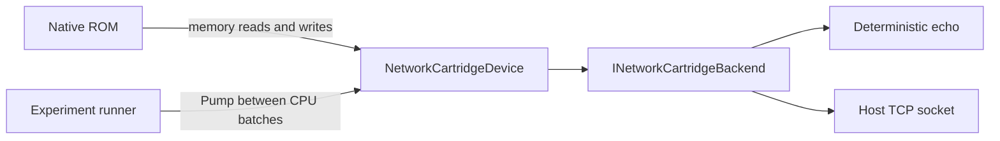

# Network cartridge experiment

Run a native Game Boy program against an experimental memory-mapped network processor:

```powershell
# Deterministic echo backend; returns at most 7 bytes per receive.
dotnet run --project GB.Experiments -c Release -- --network-cartridge

# Real TCP connection to an automatically started local echo server.
dotnet run --project GB.Experiments -c Release -- --network-cartridge --tcp

# Also export the generated 32 KiB ROM for inspection.
dotnet run --project GB.Experiments -c Release -- --network-cartridge --tcp --rom-output artifacts/netcart/demo.gb
```

Both modes print `ROM result: PASS` and `Hello from the network cartridge!`, then exit with code 0. Failure or cancellation returns 1; invalid arguments return 2. Ctrl+C cancels the run. The TCP listener binds only to loopback and an ephemeral port, handles one client and is stopped at completion. No external server, internet connection or extra package is required.

For native DHCP acquisition over the version-2 virtual UDP interface, run `--network-cartridge --dhcp`. See the [DHCP protocol, guest behavior and limitations](dhcp-cartridge-experiment.md). It uses an isolated simulated DHCP server and does not change host network settings.

The ROM executes ordinary LR35902 instructions. It probes the device, connects, writes its message to the transmit buffer, sends it, collects partial replies into work RAM, compares every byte with its ROM message, closes and halts. Result byte `$C000` is 1 on success or `$FF` on failure; the reply starts at `$C100`. C# builds the native instruction bytes and runs the emulator; there is no .NET runtime in the emulated machine. This sample does not exercise the C#-to-Game-Boy compiler.

The exported ROM has a standard ROM-only header and valid checksums. It needs the explicitly attached experimental peripheral: a normal emulator or standard cartridge has no device there and the ROM will fail its probe. This does not add a standardized cartridge type or prove a physical hardware implementation.

## Protocol version 1

The [local telemetry and cluster experiments](network-telemetry-and-cluster.md) extend this foundation
with actual UDP sockets, selectable TCP/UDP offload in version-2 buffers, SDK-compiled telemetry
and native range workers. Version-1 applications below keep their original layout.

The device overlays `$A000–$BFFF` after loading the ROM. Multibyte lengths are little-endian. All reads, including buffer reads, are non-destructive; receive data remains available until explicitly acknowledged. Unassigned registers read `$FF` and ignore writes.

| Address | Access | Meaning |
| --- | --- | --- |
| `$A000` | Read | Device identifier: ASCII `N` |
| `$A001` | Read | Version: 1 |
| `$A002` | Read | Status: connected=1, busy=2, receive-ready=4, error=8 |
| `$A003` | Write | Command: connect=1, send=2, receive=3, close=4, acknowledge=5 |
| `$A004` | Read | Error code |
| `$A005–$A006` | Read/write | Transmit length: 1–256 bytes |
| `$A007–$A008` | Read | Received length: 0–256 bytes |
| `$A100–$A1FF` | Read/write | Transmit buffer |
| `$A200–$A2FF` | Read | Receive buffer |

Error codes: none=0, invalid command=1, busy=2, invalid transmit length=3, not connected=4, transport failure=5, unread receive data=6, cancelled/timed out=7. A newly accepted command clears the previous error. A command written while busy is rejected without replacing the pending operation; its completion publishes the original operation's result. Send captures its bytes at submission, so subsequent writes cannot change an in-flight payload.

Receive returns available stream bytes, not a TCP packet or a guaranteed complete message. Zero bytes means EOF and clears connected status. Acknowledge clears the received length and buffer. Another receive is rejected while unread data exists. Connect and close clear received data when successful. The deterministic backend emits EOF when its echo queue is empty; the TCP backend waits for actual data/EOF. Each transport operation has a five-second deadline; the entire ROM run has a ten-second deadline. Failures clear connected status; reconnect or close to recover.

## Design and boundaries



`NetworkCartridgeDevice`, the transports, ROM generator and runner live in `GB.Experiments/NetworkCartridge`. Core only gains an opt-in priority overload for `MemoryMap.AddDevice` and `IInspectableMemoryRange` for side-effect-free inspection. Existing device registration retains its original priority. `Peek` and snapshots use the active peripheral's inspection method; they cannot acknowledge data or start network requests.

CPU writes queue commands; `Pump` starts asynchronous transport work and publishes completed results between bounded CPU batches. Async continuations return detached data and do not mutate device registers. The runner serializes CPU access, inspection and pumping, and owns cancellation/disposal. Backend implementations must honor cancellation and avoid synchronous blocking. The TCP destination is supplied by the host; ROM code cannot select arbitrary destinations. The demonstration uses a single socket and fixed 256-byte transmit/receive buffers.

This version-1 mode implements TCP offload: the host operating system handles TCP/IP, while the ROM sees a socket-like cartridge device. It does not implement an Ethernet interface, a guest TCP/IP stack, DNS, TLS, interrupts or a physical network cartridge. Version 2 separately supports virtual UDP datagrams and guest DHCP acquisition. The existing serial-port HTTP experiment is unchanged.

The device is attached only for this experiment, to a fresh ROM-only machine. It is not integrated into cartridge mapper selection, the player, debugger or `EmulationHost`. The runner keeps its machine private and provides no reset/save/rewind commands. Memory snapshots include register values for inspection but do not save or restore the peripheral's queues, connection or external network effects. Recreate the experiment for a reset. A future interactive integration needs an explicit cartridge lifetime and recorded input/replay or a disconnect policy for rewind.

## Validation

`GB.Emulator.Tests/NetworkCartridgeTests.cs` exercises the native ROM with 1-, 7- and 256-byte receive fragments, real localhost TCP, corrupt replies, bus mapping, non-destructive inspection, transmit ownership, invalid commands/lengths, busy operations, transport failures, cancellation/disposal and ROM checksums.

```powershell
dotnet test GB.Emulator.Tests -c Release --filter FullyQualifiedName~NetworkCartridgeTests
```
