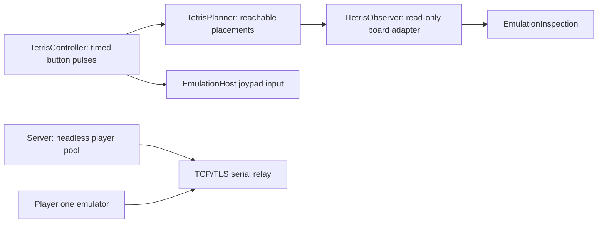

# Tetris AI opponent

The server owns a configurable pool of **headless Game Boys**, each running your
own Tetris ROM and a playing-style preset. Connecting assigns an available
opponent at random. Only your own emulator has a display and audio. The server
creates no windows or audio devices. ROM contents never cross the cable protocol
and are never included in the container image.

## Start the headless pool

From the repository root with .NET 10 (PowerShell):

```powershell
$env:LINK_TETRIS_ROM = (Resolve-Path "GB.Roms.Private/Tetris (World).gb").Path
$env:LINK_TETRIS_PLAYERS = "4"
dotnet run --project GB.Link.Server -c Release -- --bind 0.0.0.0 --port 8766
```

Or Docker Compose, with a private, read-only ROM mount:

```powershell
$env:TETRIS_ROM_PATH = (Resolve-Path "GB.Roms.Private/Tetris (World).gb").Path
$env:LINK_TETRIS_PLAYERS = "4"
docker compose -f compose.yaml -f compose.tetris.yaml up -d --build
```

For Docker in WSL, run Compose inside that distro and set `TETRIS_ROM_PATH`
to its Linux path (such as `/mnt/c/Source/SharpBoy/GB.Roms.Private/Tetris (World).gb`).
`LINK_TETRIS_PLAYERS` accepts 1–12, default 4. Slots cycle through Original,
Cautious, Tetris hunter and Strategist. Only ready title-screen bots are offered.
A busy pool queues matching clients. Disconnecting retires and rebuilds the used
machine before it is assigned again. Without `LINK_TETRIS_ROM`, the server
remains a human-to-human relay.

## Play against it

1. Run `dotnet run --project GB.Emulator.Windows -c Release -- "GB.Roms.Private/Tetris (World).gb"`.
2. Press **Ctrl+L**, enter the server address (127.0.0.1 on this PC), port 8766,
   and **Connect**. A ready opponent with the same ROM revision is assigned automatically.
3. Wait for the cable to connect. On your title screen press **Right** for
   **2PLAYER**, then **Enter/Start** through music and height selection.
   The server opponent follows the native multiplayer protocol automatically.
4. Play on your own screen. There is no player-two window. The lounge remains
   available for cable status and human invitations.

The assignment requires both the ROM-header title and SHA-256 hash to match.
Individual bots cannot be selected by name. **Random server opponent** requests
an available slot when unpaired. After unplugging, reload your ROM before a fresh
match. Selecting 2PLAYER inside the ROM cannot discover a server: connect the
virtual cable first. **Host on this PC** in the client is a relay only; use the
standalone service for headless opponents.

With TLS, bots also validate certificate trust and hostname. Set `LINK_BOT_HOST`
to a reachable certificate hostname and install its issuing CA in the server's
trust store as needed. The default bot host is the bind address, or loopback for
a wildcard bind. The service reuses its configured join token internally.

The built-in reader matches the private `Tetris (World).gb` tested locally,
SHA-256 `7FDE11DD4E594A6905DECCD57943D2909ECB37665A030741C42155AEB346323B`.
The headless pool rejects other revisions until a matching observer is implemented.
The local developer harness also supports hash-checked JSON reader profiles;
these do not automatically adapt to another revision.
The private ROM stays gitignored.

## Configure the playing style

The local developer harness (`Tools/TetrisDesktopProbe`) retains the second LCD
and **Playing style / sliders…** editor for tuning and debugging. Normal
matchmaking does not launch these windows. Editor changes apply live
at its next decision. The editor scrolls to show the reaction and button-hold
controls on smaller windows. **Save style…** and **Load style…** exchange small
validated JSON files; they are separate from ROM-reader profiles.

| Control | Raising it encourages |
| --- | --- |
| Clear lines | Taking immediate line clears |
| Chase four-line clears | Taking a four-line opportunity with the current or next piece |
| Avoid buried holes | Avoiding empty cells trapped under blocks |
| Keep the stack low | Lower total column height |
| Keep the surface flat | Smaller differences between adjacent columns |
| Protect headroom | A stronger survival penalty when columns exceed 12 rows |
| Plan for the next piece | More weight on the visible preview's best reachable placement |
| Reaction delay | Longer pauses between taps; lower is faster |
| Button hold | Longer button presses; lower is quicker, while long holds may repeat |

These are independent preferences, rather than a single guaranteed skill score.
Large four-line bonuses with little hole avoidance can produce risky play.
Start with **Strategist** for preview lookahead and quick taps, **Cautious** for
headroom/holes, or **Tetris hunter** to experiment with four-line rewards.
**Original** preserves the original four scoring weights with no lookahead.
The presets are starting points, not a measured strength ranking.

To improve strength further, evaluate styles over many identical piece sequences
and compare lines cleared, survival time and attacks sent. Tune weights against
those results rather than judging one match. Gravity-aware route simulation,
explicit well building and deeper search are useful subsequent improvements.

## Design and interface



`ITetrisObserver.Observe(EmulationInspection)` returns a detached settled board,
active piece origin and ROM-specific rotation geometry, or `null` outside
recognised gameplay. The DMG reader uses the 18 visible rows with two empty
rows above them, reads the actual piece pivot and pause/locking/menu flags,
and accounts for the game's reversed orientation numbering. Geometry was
checked against the running ROM's OAM; no Nintendo program code or artwork
is included in the adapter.

`TetrisPlanner.Choose(TetrisObservation, TetrisAiSettings)` searches paths using left, right,
rotation and down. It respects collisions rather than teleporting a piece
into a geometrically attractive location. The Original preset scores landings as:

```text
0.76 × cleared lines − 0.51 × aggregate column height
                    − 0.76 × holes − 0.18 × adjacent-height differences
```

Other styles add a four-line bonus, a quadratic ceiling penalty above 12 rows,
and an optional one-piece preview search. The DMG observer reads the actual
preview piece and its rotation from C213. A zero lookahead weight disables
the second search; a reader without preview metadata uses current-piece search.

`TetrisController.Tick(EmulationHost)` reobserves between configurable button
pulses and releases. Timing follows guest CPU cycles, so UI polling
and network waits cannot accelerate the bot. It only writes joypad input,
releases its held button on stop/pause, and never writes board memory or
manufactures serial replies. Observation, input and emulation stay on the
host's owning execution context. Searches run on a background worker over
detached board snapshots. Changed styles cancel old searches; replaced boards
or pieces invalidate results. The first move is collision-checked again after
gravity advances. Search time can extend the minimum reaction delay; it never
blocks the audio/UI thread. Disabling AI, pausing or closing cancels its search.

This is a small heuristic search bot, with no model download or training.
It models the current piece and optionally the visible preview. It does not
model gravity throughout an entire route, learn weights, explicitly reserve a
Tetris well, or optimise multiplayer garbage attacks. Current results establish
live play, not strong play: the original local two-emulator TCP run exchanged 2,310 bytes, placed 36 pieces and
cleared six lines before the bot topped out. The other emulator was idle
during gameplay, so this is not a competitive benchmark.

## Verification

Normal CI uses synthetic boards and the public SDK link demo to check four-line
clears, unreachable placements, invalid spawns, profile hash checks, guest-time
input pacing, opponent invitation ownership and clean disconnection. It does
not need the commercial ROM or run a large simulation.

To check four real headless players, native multiplayer setup, AI placement,
disconnect/reset and rematch (outside the solution and CI):

```powershell
dotnet run --project Tools/TetrisServerProbe -c Release -- "<your Tetris ROM path>"
```

For the older local two-emulator private-ROM check:

```powershell
dotnet run --project Tools/TetrisAiProbe -c Release -- "<your Tetris ROM path>"
```

This starts two headless emulators and a loopback lobby, selects multiplayer
using joypad input and checks that the bot places pieces and clears lines.
It runs outside the solution and CI. No ROM patches or guest RAM writes are used.

To check the actual Windows player, WPF opponent, audio device and UI schedulers
against a running service:

```powershell
dotnet run --project Tools/TetrisDesktopProbe -c Release -- "<your Tetris ROM path>" 127.0.0.1 8766 30
```

The desktop probe drives the ROM's menus using owner-thread joypad input,
then measures guest-clock throughput, LCD FPS and audio queue counters for
30 seconds. This developer harness explicitly opts out of server matchmaking
and invites its local bot instead. It fails on a dropped cable, a host fault, speed below 85%, or any
additional audio starvation/discarded PCM during gameplay. If no audio device
opens, it explicitly reports that audio was not verified. An optional final
`--keep-open` leaves the two windows at a paused multiplayer match after a
successful check. Press Enter in player one to resume both games.

Append `--preset Strategist` (quote names containing spaces) to exercise a
particular preset. `--mute` avoids playing a second audio stream while another
match is open; the probe reports that audio was not verified in that mode.

The GUI path exposed an external-clock re-arm race and per-byte timer delays
that the original fast headless run did not exercise. The corrected container
run maintained approximately 100% native clock speed and 59.7 FPS for 30 seconds.

RAM/state names were cross-checked against the
[Tetris disassembly research](https://github.com/kaspermeerts/tetris) and
[PyBoy's Tetris wrapper](https://github.com/Baekalfen/PyBoy/blob/master/pyboy/plugins/game_wrapper_tetris.py).
The local ROM's hash differs from that disassembly's reference revision;
runtime observations, not the reference hash, establish this reader's compatibility.
