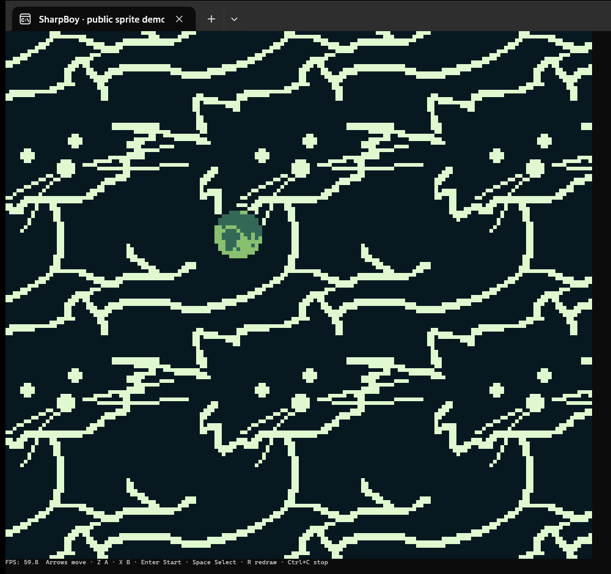
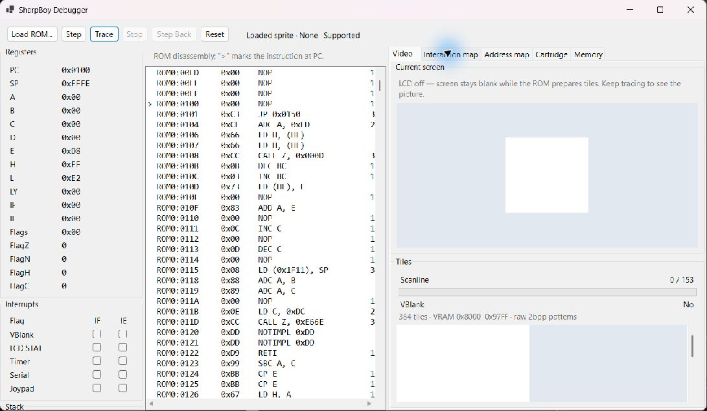
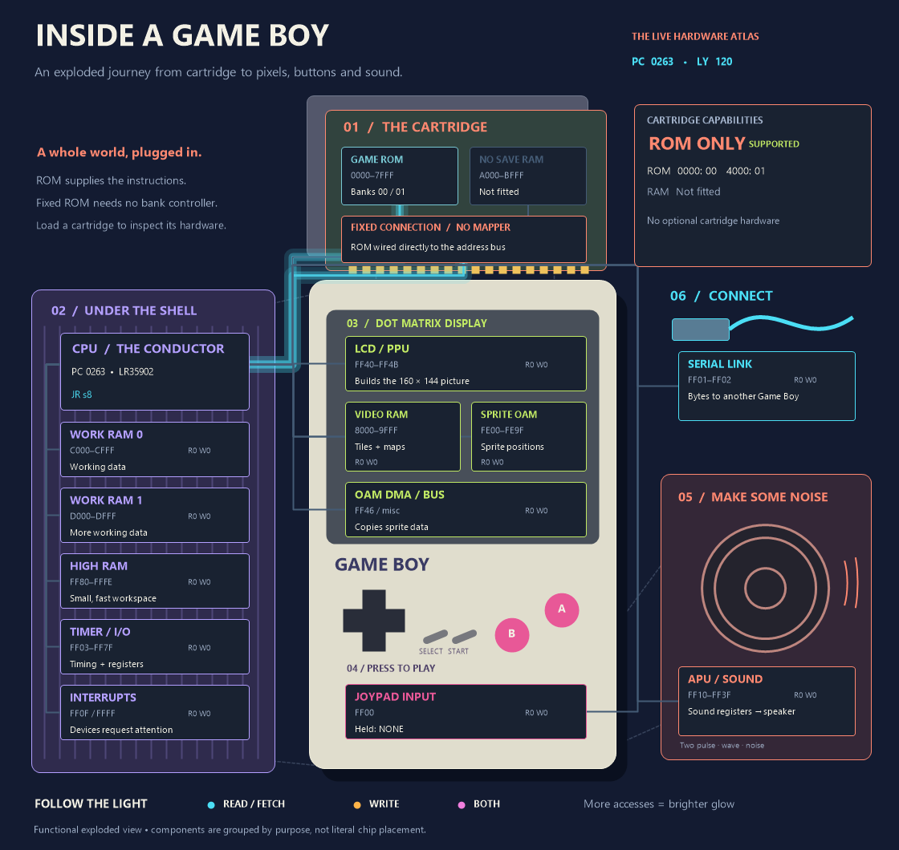
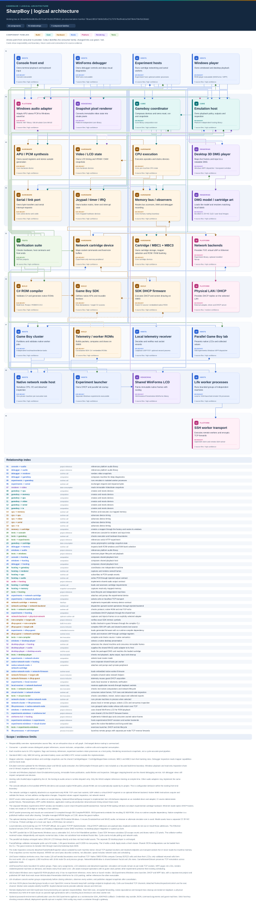

# SharpBoy

[](https://github.com/guypritchard/SharpBoy/actions/workflows/dotnet.yml)

A Game Boy emulator written in C#, with a scalable Windows player, a playable terminal front end and a Windows debugger that shows what happens inside the machine.

The experimental C#-to-DMG compiler builds native ROMs with RGBDS 0.9.0: 32 KiB ROM-only cartridges and scoped 64-512 KiB MBC1 cartridges with banked read-only assets. Samples cover a [scrolling background](Samples/ScrollingBackground/README.md), [direct-OAM sprites](Samples/Sprites/README.md), and [MBC1 assets](Samples/BankedAssets/README.md). See the [clean-checkout Windows toolchain and source-to-ROM CLI guide](Docs/csharp-gameboy-toolchain.md), [independent PyBoy validation procedure](Docs/csharp-gameboy-independent-validation.md), and the plan's explicit [remaining implementation backlog](Docs/csharp-gameboy-compiler-plan.md#what-remains-to-implement). The compiler supports a [restricted C# subset](Docs/csharp-gameboy-language.md), not arbitrary .NET programs. Both software emulators run bootless in validation; neither is independent hardware proof. Compiler sprite writes do not use OAM DMA or model DMA timing/bus blocking.

The SDK distribution has three separate packages: `GB.Sdk` is the reference-only
C# API for project validation and IntelliSense; `GB.Compiler.Cli` installs `gbc`,
the native-ROM compiler; `GB.Sdk.Templates` provides standalone `dotnet new`
blank, background and sprites starters with their own artwork. The SDK host
method bodies only throw guard exceptions: there is no alternate CLR intrinsic
implementation. See [package installation and isolated verification](Docs/csharp-gameboy-toolchain.md#sdk-packages-and-standalone-templates).

Play through a Unicode console display, or follow instructions across an exploded Game Boy: cartridge banks, CPU, memory, display, sound and input. SharpBoy is a work in progress, with an emphasis on making the hardware visible and understandable.

The console and debugger opt into a [clean-room DMG logo scroll and two-note startup](Docs/dmg-startup.md) before running cartridge code (~4.42 seconds). Debugger Step/Trace advance one animation frame per step; Reset replays it. Logo mismatches warn but never block. Core `new Gameboy()` and compiler/emulator validation remain boot-skipped by default; no boot ROM is bundled.

[Download Windows builds](https://github.com/guypritchard/SharpBoy/releases/latest) · [Run from source](#run-from-source) · [Explore the debugger](#explore-the-debugger) · [Hardware support](#hardware-support) · [Architecture](#architecture)

## See it running

### The console emulator



*The bundled `GB.Roms/SPRITE.GB` demo running in Windows Terminal with a 6-point Cascadia Mono font. The capture includes the complete Game Boy frame and the FPS/control line; unused terminal space is cropped.*

The display is real terminal text: two Game Boy pixels per character, using foreground and background colours. It needs **160 columns × 73 rows**, so a small font is essential.

### The debugger



*The debugger loaded with `GB.Roms/SPRITE.GB`: registers on the left, disassembly in the centre, and the Video tab on the right. The hardware visualisation is shown in detail below.*



*Hardware atlas detail, rendered by the debugger's diagram control from the executing `GB.Roms/SPRITE.GB` demo. This ROM-only cartridge shows fixed wiring; the controller and capability panel change with the loaded ROM.*

All screenshots use demo ROMs from [GB.Roms](GB.Roms). ROMs from `GB.Roms.Private` are excluded from documentation captures.

## Get started on Windows

1. Download the Windows player, console or debugger ZIP from the [latest release](https://github.com/guypritchard/SharpBoy/releases/latest): `win-x64` for Intel/AMD PCs, or `win-arm64` for Windows on ARM. Windows player packages are produced by builds containing the player project.
2. Extract the whole ZIP. These builds include the .NET runtime.
3. For the player, launch `GB.Emulator.Windows.exe` and use **File → Open ROM…**, drag in a `.gb` file, or choose **Load bundled demo**. For the debugger, launch `GB.Debugger.exe`, click **Load ROM…**, and choose a `.gb` file.
4. For console play, configure your terminal as described below, then run the executable with a ROM path:

```powershell
.\GB.Emulator.Console.exe "C:\Games\your-game.gb"
```

Without a path, the console uses the bundled `SPRITE.GB` demo.

### Windows player

The player reuses `GB.Emulator.Core` for hardware, startup and rendering, and
`GB.Emulator.Core.Win32` for audio. Resize freely: the display stays centered with
its original aspect ratio. **View → Window size** selects 2×–6×, and **Integer
scaling** keeps evenly sized pixels. Disable integer scaling to fit the available
space more closely. Windows controls scale with per-monitor DPI; very small
windows are limited by their controls' minimum size.

- **Ctrl+O** opens a ROM; a path can also be passed on the command line.
- **Ctrl+P** pauses/resumes; **Ctrl+R** resets and replays startup. Reset clears cartridge RAM.
- **F11** toggles fullscreen; **Esc** leaves it. The previous window size/state is restored.
- **View → Show FPS and speed** enables LCD frame rate and emulation speed relative to the original clock. Paused time is excluded; this is emulation throughput, not monitor refresh rate.
- **Ctrl+I** opens the optional, resizable inspector with cartridge capabilities and live bank selection, CPU/hardware registers, and a read-only memory viewer. Inspection refreshes at most four times per second, independently of playback.
- **Emulation → Mute audio** controls sound. Playback pauses on loss of application focus by default; this can be disabled. Held game buttons are released on focus loss and pause.

Game controls are **arrows**, **Z/X**, and **Enter/Space**. Playback uses bounded
CPU batches and a reused frame bitmap; slow window operations cannot accumulate
an unbounded catch-up queue. Audio stops on pause and shutdown and can be absent
without preventing play. The existing core's hardware and save limitations below
also apply to this player.

Run from source:

```powershell
dotnet run --project GB.Emulator.Windows -c Release
dotnet run --project GB.Emulator.Windows -c Release -- "GB.Roms/SPRITE.GB"
```

### Make the console fit

A Game Boy screen is 160 × 144 pixels. SharpBoy packs vertically adjacent pixels into `▀`/`█` characters, producing a **160-column, 72-row picture**, plus one status row.

Use a terminal with UTF-8, ANSI true colour and a monospaced font with block characters. In Windows Terminal:

- Set a small font for the emulator profile. **6 points** worked for the capture above; your display scaling may need a different size.
- Make the window at least **160 columns wide and 73 rows high** before launching. A wide window alone is not enough: all 73 rows must fit vertically.
- Use a font such as Cascadia Mono and reduce terminal padding if space is tight.
- Press **R** to repaint after changing the window size. A subsequent frame also clears and redraws after resizing.

If you see `Console video requires at least 160 columns and 73 rows`, reduce the font size or enlarge the terminal, then launch again. Redirected output is unsupported because the renderer needs an interactive terminal.

### Controls

| Game Boy button | Keyboard |
| --- | --- |
| D-pad | Arrow keys |
| A | **Z** |
| B | **X** |
| Start | **Enter** |
| Select | **Space** |
| Repaint console | **R** |
| Stop console | **Ctrl+C** |

The debugger accepts game buttons from every tab. On Windows, console input tracks physical key state; quick taps last at least 30 ms. Other terminal platforms use short holds extended by key repeat. The debugger releases held buttons when it loses focus.

## Explore the debugger

Load a ROM, choose a tab, then use **Step**, **Trace**, **Stop**, **Step Back** and **Reset** to follow execution. **F10** steps one instruction; **Shift+F10** steps back.

| View | What it shows |
| --- | --- |
| **Video** | Current 160 × 144 screen, the 384-tile VRAM atlas, scanline and VBlank status. |
| **Interaction map** | An exploded Game Boy with live reads, writes, instruction fetches and a bus log. |
| **Address map** | The complete `0000–FFFF` address space, access activity and active cartridge banks. |
| **Cartridge** | ROM header, mapper, declared sizes, display modes, active banks and support limitations. |
| **Memory** | Memory inspection alongside disassembly, registers, interrupts and stack state. |

### Follow the hardware

In **Interaction map**, choose **Fit poster** to see the whole machine, or **100% / read labels** for a scrollable view at full size.

- **Cyan:** reads and instruction fetches.
- **Amber:** writes.
- **Violet:** both reads and writes.

Trace accumulates activity across instructions: more accesses produce brighter light, which fades when activity stops. The bus log lists the latest instruction's addresses; the glow shows recent activity rather than a permanent history.

ROM reads light the cartridge ROM. Writes to mapper-control addresses light the bank controller instead. Cartridge appearance reflects its hardware:

| Cartridge | Visualisation |
| --- | --- |
| ROM only | Fixed wiring with no bank-controller chip. |
| MBC1 | Violet controller showing simple or advanced banking mode. |
| MBC3 | Cyan controller with independent ROM/RAM selection. |
| Unimplemented mapper | Dashed controller outline with an unavailable label. |

The capability panel shows both ROM windows, selected RAM bank, RAM enable state and optional hardware limitations. **Step Back** restores mapper registers and every cartridge RAM bank as part of the emulator snapshot. **Reset** reloads the cartridge and resets its state.

The Video tab reconstructs the screen from current VRAM, OAM and LCD registers, combining background, window and sprites. It refreshes while stepping/tracing and after relevant writes, including OAM DMA at `FF46`. Mid-frame effects require a more accurate pixel pipeline.

## Hardware support

| Area | Current implementation |
| --- | --- |
| CPU | All 245 documented unprefixed and 256 `CB` opcodes; undefined opcodes raise an error. Interrupt entry, delayed `EI`, `RETI` and the HALT bug are handled. |
| ROM only | Fixed cartridge ROM. |
| MBC1 | Types `01–03`: ROM banking, RAM enable/disable, both banking modes and banked RAM. Standard wiring supports up to 2 MiB ROM with 8 KiB RAM, or 512 KiB ROM with 32 KiB RAM. |
| MBC3 | Types `11–13`: ROM and cartridge RAM banking. RTC hardware is not implemented. |
| Display | DMG monochrome screen reconstruction, LCD timing, background/window/sprites and OAM DMA. Full pixel-pipeline accuracy remains in progress. |
| Sound | Two pulse channels, wave audio and noise, with stereo routing/volume. Windows front ends play PCM through the shared audio adapter. |
| Input/timer | Joypad button matrix and interrupts; timer hardware. |
| Serial | Functional byte transfers, completion interrupt and link-cable abstraction; individual bits are not yet shifted during transfers. |
| Other cartridge hardware | MBC1M multicarts, other mappers, RTC, rumble and motion sensors are unavailable. |
| Enhanced systems | Game Boy Color mode and Super Game Boy enhancements are unavailable. DMG-compatible CGB cartridges can use their DMG mode. |

Mapper support does not guarantee that every game runs correctly. The Cartridge tab reports requirements and limitations for the ROM you load; battery-backed or enhanced-system cartridges may be marked partial even when banking works.

### Battery saves and Step Back

**There are currently no persistent battery save files.** Cartridge RAM lives in memory for the current emulator session. SharpBoy does not read or write `.sav` files and has no save-directory setting.

Closing the app, loading another cartridge or resetting loses that RAM. Debugger Step Back snapshots preserve cartridge RAM while the session is running; they are not disk saves. Persistent battery storage is still to be implemented.

## Run from source

Use the **.NET 10 SDK**. The WinForms debugger requires Windows. Windows audio is provided by a separate platform library; the console can continue silently on other platforms with a suitable terminal.

```powershell
git clone https://github.com/guypritchard/SharpBoy.git
cd SharpBoy
dotnet restore GB.Emulator.sln
```

Start the console in a terminal large enough for its display:

```powershell
dotnet run --project GB.Emulator.Console -c Release -- "C:\Games\your-game.gb"
```

Start the debugger:

```powershell
dotnet run --project GB.Debugger -c Release
```

Use the bundled demo explicitly:

```powershell
dotnet run --project GB.Emulator.Console -c Release -- "GB.Roms\SPRITE.GB"
```

To load another ROM, pass its path as the command-line argument. Private ROMs are not copied into build or publish output automatically.

Build and test:

```powershell
dotnet build GB.Emulator.Console/GB.Emulator.Console.csproj -c Release
dotnet build GB.Debugger/GB.Debugger.csproj -c Release
dotnet build GB.Emulator.Windows/GB.Emulator.Windows.csproj -c Release
dotnet test GB.Emulator.Tests/GB.Emulator.Tests.csproj -c Release
dotnet test GB.Emulator.Hosting.Tests/GB.Emulator.Hosting.Tests.csproj -c Release
dotnet test GB.Emulator.Windows.Tests/GB.Emulator.Windows.Tests.csproj -c Release
```

To compile your own native ROM, install the exact official RGBDS 0.9.0 Windows ZIP (MIT) with the [verified SHA-256 and Python 3.11 / PyBoy 2.6.0 (LGPL-3.0-only) setup](Docs/csharp-gameboy-toolchain.md). Once `$bin` points to the verified RGBDS directory:

```powershell
dotnet run --project GB.Compiler.Cli -c Release -- --rgbds-bin $bin --out artifacts/ci/scrolling.gb --title SCROLLING --background-tiles Samples/Assets/background.2bpp --background-map Samples/Assets/background.tilemap Samples/ScrollingBackground/ScrollingBackground.cs
dotnet run --project GB.Debugger -c Release
```

Click **Load ROM…** and select `artifacts/ci/scrolling.gb`. The compiler also produces `.asm`, `.sym` labels, `.map` layout and `.memory.txt` memory usage next to the ROM. These provide manual source-to-label inspection, **not** debugger source-level integration. Compile errors identify source locations and diagnostic codes; see the [CLI diagnostics](Docs/csharp-gameboy-toolchain.md). CI smoke-checks all five outputs and the 32768-byte ROM; configured compiler and emulator test TRX reports must be nonempty and have **zero skipped/inconclusive tests**. The generated `artifacts/ci` files are ignored and are not uploaded with release application packages.

The [banked-assets sample](Samples/BankedAssets/README.md) extends this ROM-only path with **asset-only MBC1 type `$01` without RAM**: 4/8/16/32 banks, code and bank-switch helper in ROM0, display data in bank 1, declared assets in banks 2+, and `$D000-$D7FF` WRAM staging. Copy/read operands must be compile-time constants; each copy restores the previous bank. Interrupts remain disabled. Function banking, save RAM, >32 banks, VRAM/DMA transfers, reentrancy and managed arrays are not supported. Configured compiler tests build and execute all four sizes in SharpBoy and validate a 4-bank image in PyBoy.

## Architecture



[Open the architecture diagram](Docs/architecture.svg) · [Source-backed architecture model](Docs/architecture.json)

| Project | Responsibility |
| --- | --- |
| `GB.Emulator.Core` | CPU and hardware devices, memory routing, cartridge mappers, snapshots and platform-independent DMG rendering. |
| `GB.Emulator.Hosting` | Shared `EmulationHost`: playback, pacing, immutable frames, audio contracts, statistics, inspection and debugging. |
| `GB.Emulator.Hosting.Tests` | Independent-machine, host lifecycle, frame/audio, inspection and debugger regression tests. |
| `GB.Emulator.Console` | Unicode terminal display, keyboard input and paced playback. |
| `GB.Debugger` | WinForms stepping, disassembly, state inspection, hardware atlas and screen/tile views. |
| `GB.Emulator.Core.Win32` | Shared Windows audio output adapter implementing the host's audio contract. |
| `GB.Emulator.Windows` | DPI-aware WinForms player, scaled display, ROM dialogs, playback controls and optional live inspector/statistics. |
| `GB.Emulator.Windows.Tests` | Player pacing, scaling, input and Windows UI/lifecycle regression tests. |
| `GB.Experiments` | HTTP-to-emulated-serial experiments and isolated emulator workers. |
| `GB.Emulator.Tests` | Hardware, execution, mapper, rendering, input and experiment regression tests. |

`Gameboy` composes and resets the hardware. `MemoryMap` routes reads/writes and DMA; the cartridge factory selects a mapper from the header. The shared `CartridgeMapper` owns ROM/RAM storage and mapped windows, while MBC1/MBC3 own their banking rules and snapshots. Silent and recording memory observers allow continuous play and debugger tracing through the same CPU execution path.

The core does not depend on terminal or drawing APIs. Each machine owns its CPU registers, flags, memory reference and instruction handlers; independent machines can run in one process. Console, Windows player and debugger compose the shared `EmulationHost`. It owns playback state, pacing, immutable frames, audio routing, statistics, inspection and bounded debugger rewind. Front ends provide presentation, physical input and scheduling. See [hosting another UI](Docs/emulation-host.md) for contracts, ownership and examples. Experiment workers retain process isolation as a host policy.

## Link-port web experiment

Run a small ROM as a local HTTP service through the emulated serial port:

```powershell
dotnet run --project GB.Experiments -- --port 8765
curl.exe http://127.0.0.1:8765/
curl.exe http://127.0.0.1:8765/api/primes/10
```

The built-in ROM replies `Hello from the Game Boy serial port!`; the prime endpoint returns `{"n":10,"prime":29}`. The prime search executes in the ROM using work RAM. Indices `1–6542` are supported, ending at 65521; invalid indices return HTTP 400.

The listener binds to `127.0.0.1`. By default it uses up to four isolated emulator worker processes and distributes requests round robin. Use `--workers 8` for eight workers, `--rom path/to/program.gb` for a ROM implementing the serial protocol, or `--benchmark` to measure worker counts.

The protocol sends `G` for the greeting, or `P` followed by a 16-bit little-endian index and search ceiling for primes. Replies are zero-terminated ASCII or a two-byte little-endian prime respectively. The search ceiling is at most `min(65535, 16 * n)`.

## Builds and releases

[GitHub Actions](https://github.com/guypritchard/SharpBoy/actions/workflows/dotnet.yml) builds the full solution, runs configured compiler/PyBoy and emulator tests with a zero-skip TRX gate, smoke-builds the sample, and publishes self-contained `win-x64`/`win-arm64` console/debugger artifacts. Successful builds on `master` also create a GitHub release with separate console/debugger ZIPs. Pull requests, tag pushes and manual builds upload artifacts without creating a release. CI installs RGBDS/PyBoy only into runner temp; generated ROMs, venvs and tools are not included in the published packages.

GitVersion calculates assembly and artifact versions from Git history using GitHub Flow. Tags of the form `v<major>.<minor>.<patch>` set a release version; commit messages can request a larger increment with `+semver: minor` or `+semver: major`. Automatic release notes use the built commit's full message.

## Implementation references

- [SharpBoy opcode manual](https://guypritchard.github.io/SharpBoy-Opcode-Manual/)
- [Pan Docs](https://gbdev.io/pandocs/)
- [Game Boy opcode tables](https://www.pastraiser.com/cpu/gameboy/gameboy_opcodes.html)
- [Game Boy CPU manual](http://marc.rawer.de/Gameboy/Docs/GBCPUman.pdf)
- [Opcode-generation notes](https://meganesulli.com/generate-gb-opcodes/)
- [Cinoop emulator walkthrough](https://cturt.github.io/cinoop.html)
